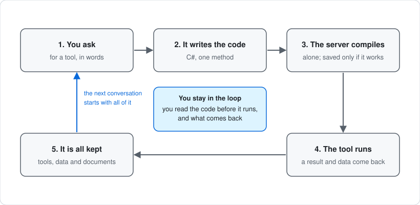

# HumAiGo

An [MCP](https://modelcontextprotocol.io) server, written in C#, that lets an AI assistant **add tools to itself and use
them in the same conversation**.

You ask for a tool. The assistant writes its C# code, the server compiles it, saves it and runs it, and the tool is still
there in the next conversation.

```
assistant ── AddMethod(code) ──────► server ── compiles ──► store (one file per tool)
          ◄── the tool is ready ───
assistant ── CallMethod("Tool", args) ─► result

next conversation: the tools, and the data they saved, are still there
```



> **Read [SECURITY.md](SECURITY.md) first.** A tool runs inside the server process with your permissions, and there is no
> sandbox. HumAiGo is meant for a development machine or a virtual machine.

## What it is for

- **Prototyping an MCP tool in one conversation** instead of in one project. When the tool is good, its code is a
  normal C# method you can move into a regular server.
- **Compiling once and calling many times.** A tool is typed, has a schema, and is called as it is, instead of being
  rewritten and run again each time.
- **Keeping what a session produced.** Tools and data are saved, so the next session starts from them. Each registry (a
  toolbox) holds its own tools and data.
- **Adding tools from a client that has no shell,** such as a chat application that only speaks MCP.

## What it is not

- It is not a sandbox, and it is not autonomous: the assistant proposes, and you approve what runs.
- It is not needed if your assistant already has a shell and you are happy with throwaway scripts. The difference is that
  here the tool is compiled, typed, saved and reachable from any MCP client.

## Quick start

You need the [.NET 8 SDK](https://dotnet.microsoft.com/download/dotnet/8.0) to build, or a self-contained build from the
releases page.

```
dotnet publish src/HumAiGo/HumAiGo.csproj --configuration Release --output publish
```

Then declare the server in your MCP client. For Claude Desktop, open the configuration file (Settings, Developer, Edit
Config) and add:

```json
{
  "mcpServers": {
    "humaigo": {
      "command": "C:\\path\\to\\publish\\humaigo.exe",
      "args": []
    }
  }
}
```

On Linux and macOS, `command` is the path of the `humaigo` executable. Quit the client completely and start it again.

Some pitfalls: the configuration file must be UTF-8 **without** a byte order mark, and the client may rewrite the file
when it closes, so check it after a restart.

Then try, in a conversation:

> Add a tool that returns the square of a number, then use it on 12.

and, with the Internet:

> Add a tool that gives the current weather for a latitude and a longitude, using the free Open-Meteo API, and use it for
> 46.95, 7.45.

## How the assistant uses it

The assistant calls `AddMethod` with the code of one method:

```csharp
[McpMethod("Returns the square of an integer")]
public int Square(int n) => n * n;
```

- Each tool is **compiled on its own**. A mistake in one never affects another, and the code is saved **only after it
  compiled**: a failed `AddMethod` leaves nothing behind, and the compiler errors are returned so the assistant can
  fix them.
- A tool added during a conversation is called with **`CallMethod`**, because most clients read the tool list once, at
  startup. After a restart it is a tool of its own.
- A tool can **reuse other tools by copy**: `AddMethod(code, dependencies: ["Add", "Multiply"])` copies their code into the
  new one, and records a hash of each. `CheckOutdatedDependencies` reports the copies whose source has changed.
- `UpdateMethod` compiles the new version first, and keeps the previous one if it does not compile.
- `System`, `System.Collections.Generic` and `System.Linq` are imported in every tool; use full names for the rest.

`GetHowTo` returns these instructions to the assistant itself, so it can learn them from the server.

## Toolboxes (registries)

A registry is a folder under `data/` with its own tools and data, and one registry is active at a time.

- Choose the one used at startup with `--registry <id>`, or the `HUMAIGO_REGISTRY` variable, or `registryid` in
  `humaigo_config.json`.
- `ListRegistries` and `SwitchRegistry` show them and change the active one without restarting.
- Several entries in the client configuration can start the same executable on different registries.

## The base methods

| Method | What it does |
| --- | --- |
| `AddMethod`, `UpdateMethod`, `RemoveMethod` | Add, replace and remove a tool |
| `CallMethod`, `GetAvailableMethods` | Call any tool, and list them |
| `ReloadRegistry`, `CheckOutdatedDependencies` | Recompile from the store, and report outdated copies |
| `SetData`, `GetData`, `ListAllData`, `RemoveData` | A small key-value store, with optional tags and filters, for what a tool wants to keep |
| `ListRegistries`, `SwitchRegistry` | Toolboxes |
| `GetHowTo`, `GetBaseMethods`, `GetInstallDirectory`, `GetRegistryPath`, `GetRegistryReferenceMetaData` | Help and information |

Base methods cannot be changed or removed by the assistant.

## Documents for your assistant

A registry can also hold Markdown **documents**: data kept under keys that start with `doc:`, with tags such as
`kind:skill`, `kind:security` or `kind:howto`. `GetHowTo` ends with an index of them, so an assistant sees at the start
of a conversation what guidance this toolbox carries, and reads the one that applies before it acts. A toolbox can
thus carry roles, procedures, rules and recipes along with its tools. It is guidance, not enforcement. See
[`examples/harness`](examples/harness).

## Examples

The [`examples/`](examples) folder holds five, compiled and run by the tests: an API called in one request, tools that
reuse each other by copy, tools whose data a later conversation picks up, Markdown documents that guide the assistant, and a toolbox folder applied to a registry.

The release archives carry the same folder next to the executable, so the files are on disk: `GetInstallDirectory` tells
where. From a clone, `dotnet run --project src/HumAiGo -- --registry demo` starts the server on a test toolbox.

## What is checked

The tests build the registry in memory, start the real executable and talk to it, and use the official MCP C#
client against it. They include a test where two server processes write to the same registry at once, because some
clients start two.

- **Windows** is where it is developed and used. **Linux** is tested in a .NET 8 container. **macOS** is not tested.
- **Clients:** Claude Desktop, and the official MCP C# client in the tests. Other clients are untested.
- **Protocol:** MCP over standard input and output. Tools only: no resources, no prompts. Versions 2024-11-05 to 2025-11-25.

## Development

```
dotnet build HumAiGo.sln
dotnet test HumAiGo.sln
```

See [CONTRIBUTING.md](CONTRIBUTING.md). The code is under `src/`: the executable (`HumAiGo`) holds the protocol, and the
library (`HumAiGo.McpServer`) holds the registry, the compiler and the store.

## Known limits

- A tool runs with the server's permissions, and nothing restricts it. See [SECURITY.md](SECURITY.md).
- The store is plain text, with no encryption. Do not keep secrets in it.
- Startup compiles every saved tool again: about 0.75 s, plus about 15 ms per tool.
- Clients that do not refresh their tool list during a conversation need `CallMethod` for a tool added a moment ago.

## Status

HumAiGo 0.1.0 is experimental. It is small on purpose, it is MIT-licensed, and it is meant to be read, changed and
forked. It is maintained on a best-effort basis, with no promise about response times.

## History

How it came to be, a version-by-version timeline, and research notes on related ideas that are **not** implemented here
(a "Node" that extends itself without a human, tools shared between peers) are in [`docs/history`](docs/history).

## License

[MIT](LICENSE).
